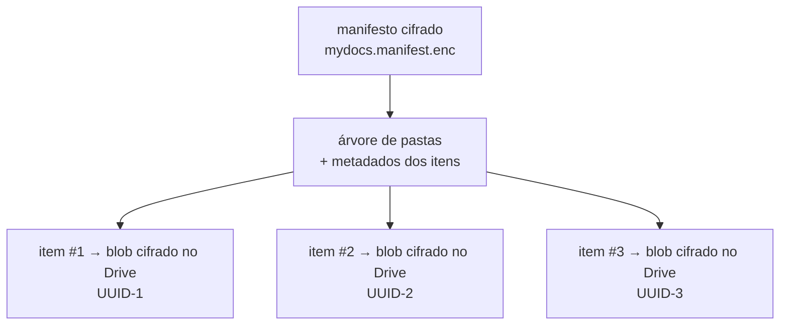
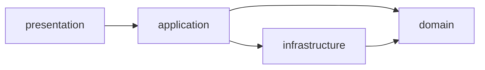
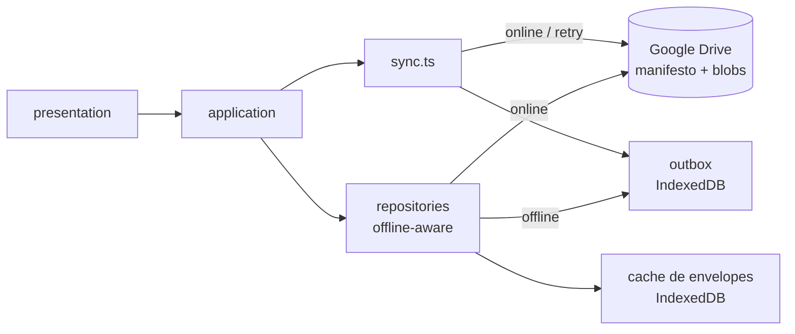

# MyDocs — Arquitetura (SOLID)

Este documento descreve como o MyDocs aplica os princípios **SOLID** em uma
arquitetura em camadas (Clean Architecture / Ports & Adapters), mantendo os
requisitos do MVP (`ESCOPO_MVP.md`, RF01–RF20, RNF01–RNF11).

> A base é a mesma do projeto **Minhas Ações (carteira)**: camadas
> `domain` / `application` / `infrastructure` / `presentation`, Google Drive
> com escopo `drive.file`, criptografia com Web Crypto e PWA offline-first.
> O que muda é o **domínio**: aqui o cofre guarda **arquivos** (blobs), não
> células de planilha.

---

## 1. Modelo de armazenamento (decisão central)

O cofre **não** é um único arquivo JSON (como na carteira). Para suportar
arquivos de até 10 MB e "abrir/compartilhar um item sem reescrever o cofre
inteiro", o MyDocs usa um modelo híbrido:



- **1 item = 1 arquivo no Drive**, com nome opaco (`UUID`), dentro da pasta
  exclusiva do app (`mydocs_vault`). O conteúdo é `gzip(original)` cifrado com
  AES-256-GCM.
- **1 manifesto cifrado** (`mydocs.manifest.enc`) guarda a árvore de pastas
  (virtuais), os metadados de cada item (nome real, tipo, tamanho, mime, datas)
  e o mapeamento item → ID do blob no Drive + parâmetros de cifra.
- **Subpastas são virtuais**: mover/renomear um item é só editar o manifesto —
  nenhuma chamada extra ao Drive e **nenhum metadado vaza** (o Google só vê
  UUIDs).

Consequências práticas:

- O limite de **10 MB** aplica-se ao arquivo original (antes de compactar/cifrar).
- O manifesto é o ponto de concorrência: escrita com **etag + `If-Match`** e
  reaplicação em conflito (HTTP 412), como no app de carteira.
- A decifra é **sob demanda**: listar o cofre só precisa do manifesto; o
  conteúdo de um item só é decifrado ao abrir/compartilhar/baixar.

---

## 2. Camadas

```
src/
├── domain/            # Núcleo: modelos, regras de negócio e ports
├── application/       # Casos de uso (orquestração), sem UI nem infraestrutura
├── infrastructure/    # Adaptadores: Drive, cripto, compressão, cache, outbox, share
│   ├── cripto/        # Web Crypto (PBKDF2/AES-GCM), envelope, chave em memória, cofre local
│   ├── drive/         # API do Google Drive: pastas e blobs (drive.file)
│   ├── vault/         # Manifesto + codec dos itens (domínio ⇄ Drive)
│   ├── share/         # Web Share API (saída)
│   └── storage/       # IndexedDB cifrado, cache, outbox, db/kvStore
└── presentation/      # UI React: app, features, components, hooks
```

A regra de dependência é unidirecional:



- **`domain`** não conhece React, `fetch`, `localStorage` ou `Date.now()` — é
  puro, testável e determinístico.
- **`application`** orquestra casos de uso usando domínio e repositórios.
- **`infrastructure`** implementa os ports definidos no domínio.
- **`presentation`** consome apenas casos de uso e módulos puros do domínio.

---

## 3. Domínio (regras de negócio puras)

| Módulo | Onde vive |
| --- | --- |
| **Modelos de negócio** | `domain/entities.ts` — `Vault` (cofre), `Item` (arquivo), `Nota`, `PastaVirtual`, `Manifesto` |
| **Tipos e validações** | `domain/itemId.ts` (UUID), `domain/mime.ts` (tipos suportados), `domain/tamanho.ts` (bytes), `domain/nome.ts` (regras de nome válido) |
| **Regras de negócio (funções puras)** | `domain/arvore.ts` (árvore de pastas: criar/mover/renomear/resolver caminho), `domain/validacaoUpload.ts` (limite de 10 MB, mime permitido), `domain/editor.ts` (serializar `.md`/`.html`), `domain/preview.ts` (classificar item em imagem/texto/markdown/outro) |
| **Formato do envelope** | `domain/envelope.ts` — magic, cabeçalho em claro, Base64 e validação de senha (sem Web Crypto) |
| **Ports (contratos)** | `domain/ports.ts` — `VaultRepository`, `ItemStore`, `CryptoProvider`, `SharePort`, `ShareTargetPort`, `Clock` |
| **Vocabulário** | `Cofre (Vault)`, `Item`, `PastaVirtual`, `Manifesto`, `Blob cifrado`, `Envelope`, `Outbox`, `Desbloquear/Bloquear` |

---

## 4. Tradução domínio ⇄ Drive (adaptadores)

`infrastructure/vault/*` traduz entre o domínio e o Google Drive para que a
"língua" do Drive (IDs, nomes opacos, parents, MIME) nunca vaze para o domínio:

- `manifestoCodec.ts` (domínio puro) — formata/normaliza o manifesto
  (`{ version, pastas, itens }`) e é a fonte única do schema.
- `itemCodec.ts` — conversão `Item` ⇄ registro do manifesto (id, nome, mime,
  tamanho, idBlob, iv, etc.).
- `vaultRepository.ts` — implementa `VaultRepository` sobre o manifesto no
  Drive: read-modify-write com etag + `If-Match`, idempotência e reaplicação.
- `itemStore.ts` — implementa `ItemStore`: upload/leitura/remoção dos blobs
  cifrados no Drive (um arquivo por item, nome UUID).
- `drive/api.ts` — primitivas HTTP do Drive (criar pasta, listar, criar/ler/
  excluir arquivos), com timeout e escopo `drive.file`.
- `drive/pasta.ts` — garante a pasta exclusiva `mydocs_vault`
  (`ensureAppFolder`), tudo dentro do escopo `drive.file`.

---

## 5. Princípios SOLID

| Princípio | Aplicação |
| --- | --- |
| **S** — Responsabilidade única | `domain/arvore.ts` move itens; `infrastructure/vault/itemStore.ts` fala com o Drive; `presentation` só renderiza. |
| **O** — Aberto/fechado | Novos tipos de visualização (ex.: PDF no futuro) entram em `domain/preview.ts` sem alterar os consumidores. |
| **L** — Substituição de Liskov | `ItemStore` (Drive) pode ser trocado por um `ItemStore` local para testes sem quebrar os casos de uso. |
| **I** — Segregação de interfaces | `VaultRepository` (manifesto) é separado de `ItemStore` (conteúdo) e de `SharePort` (compartilhamento). |
| **D** — Inversão de dependência | O domínio define os ports; a infraestrutura os implementa. |

---

## 6. Casos de uso (application)

- `application/vault.ts` — abrir/criar cofre, carregar manifesto (cache-first).
- `application/pastas.ts` — criar/renomear/excluir pastas virtuais.
- `application/itens.ts` — upload (valida 10 MB → compacta → cifra → sobe blob →
  atualiza manifesto), mover, renomear, excluir.
- `application/preview.ts` — abrir um item (decifrar sob demanda) e classificá-lo
  para visualização (imagem/texto/markdown/outro).
- `application/editor.ts` — criar/editar notas `.md`/`.html` (usa `domain/editor`);
  a UI de edição é CodeMirror 6 + preview (ver Seção 7).
- `application/share.ts` — decifrar o item, montar `File`/`Blob` e acionar o
  `SharePort`; fallback para download quando não houver Web Share.
- `application/recebidos.ts` — processar itens recebidos pelo share target:
  validar (10 MB), sugerir a pasta de destino e disparar o mesmo pipeline de
  upload (gzip → cifra → blob → manifesto).
- `application/criptografia.ts` — desbloquear/bloquear, ativar/estado do cofre e
  mensagens exibidas pela UI; concentra pré-condições (Web Crypto disponível,
  online, outbox vazio).
- `application/sync.ts` — sincronização da fila offline (FIFO), reconexão e
  `contarPendencias()`; o flush reaplica no manifesto (1 leitura + 1 escrita) e
  a fila só é limpa após gravar.
- `application/conexao.ts` — vincula o cofre local ao Google Drive **sem pedir a
  senha de novo** (usa a chave de sessão): cria o manifesto quando a pasta está
  vazia, ou baixa o mais recente, mescla com o local (`domain/fusao.ts`), envia
  os blobs que faltam e atualiza o manifesto. Também concentra a escolha do
  manifesto correto (a pasta pode ter mais de um) e a adoção do cofre do Drive
  quando a senha informada é a dele.

---

## 7. Adaptadores (infrastructure)

- `cripto/*` — primitivas e envelopes com Web Crypto:
  - `webCrypto.ts` — PBKDF2-HMAC-SHA256 + AES-256-GCM nativos.
  - `envelope.ts` — cifrar/decifrar um blob (arquivo ou manifesto).
  - `chaveSessao.ts` — chave derivada em memória **e** no IndexedDB (store
    `chaves`, chave AES **não-exportável**), para reabrir o cofre sem a senha.
  - `verificadorLocal.ts` — desbloqueio offline (bloco fixo cifrado + parâmetros
    do KDF gravados no IndexedDB).
- `drive/*` — Google Drive via `drive.file`: `api.ts`, `pasta.ts`.
- `vault/*` — manifesto e itens (ver Seção 4).
- `compression.ts` — gzip nativo (`CompressionStream`) **antes** da cifra.
- `share/*` — Web Share API (saída) e Web Share Target (entrada via service
  worker); `SharePort` e `ShareTargetPort` definidos no domínio.
- `storage/db.ts` + `kvStore.ts` — IndexedDB (stores `cache`, `outbox`,
  `inbox` de Recebidos e `chaves` de sessão) com espelho em memória para
  leitura síncrona.
- `storage/cache.ts` — cache local dos **envelopes cifrados** (nunca conteúdo
  em claro).
- `storage/outbox.ts` — fila persistente de mutações offline.
- `storage/offlineRepositories.ts` — decorador que roteia escritas para o outbox
  quando offline (atualização otimista no cache).
- `googleIdentity.ts`, `googleConfig.ts` — OAuth 2.0 e organização no Drive.
- **Editor (presentation)** — CodeMirror 6 (`@uiw/react-codemirror` +
  `@codemirror/lang-markdown` / `@codemirror/lang-html`) para editar; preview de
  Markdown com `react-markdown` + `remark-gfm` e preview de HTML em `iframe` com
  `sandbox` + `srcDoc`. O mesmo renderizador Markdown é reaproveitado na
  visualização (RF10).

---

## 8. PWA & Offline-first

O app é um **PWA instalável** (`vite-plugin-pwa`) com funcionamento offline. O
service worker cuida do **app shell** (assets estáticos); os **dados** são
cacheados pela aplicação (nunca pelo SW, pois as requisições ao Google carregam
`Bearer token`).



- **Leitura offline**: cache-first — a listagem do cofre vem do manifesto em
  cache; o conteúdo de um item aberto recentemente vem do cache cifrado.
- **Escrita offline**: `offlineRepositories.ts` aplica a mutação de forma
  otimista no cache e enfileira no outbox.
- **Sincronização**: `application/sync.ts` reaplica a fila em FIFO, renova o
  token em 401, interrompe em falha de rede/quota (mantendo o item) e refresca
  o cache. Disparada pelo `VaultProvider` (mount, reconexão) e pelo botão
  "Não sincronizado".
- **Auth offline**: o `AuthProvider` não desloga por falta de rede.

### 8.1 Fluxo local-first e sincronização opcional

O app **não exige conta Google para começar**. Na primeira abertura o usuário só
escolhe a senha do cofre: a chave é derivada (PBKDF2), o verificador local é
gravado e um manifesto vazio vai para o IndexedDB — tudo local. As operações
(notas, uploads, pastas) funcionam nesse modo, com o `ItemStore` local.

O header mostra um botão vermelho **"Não sincronizado"** enquanto o cofre não
está vinculado (ou está pendente, ou o token expirou). Ao tocar:

1. `AuthProvider.garantirToken()` faz o login (ou renova o token) do Google.
2. `application/conexao.ts` garante a pasta do app e localiza o manifesto:
   - **não existe** → cria `mydocs.manifest` e envia todos os blobs locais;
   - **existe** → baixa o mais recente, mescla com o local (item mais recente
     vence) e atualiza manifesto + blobs que faltam.
3. Nada de senha: a chave de sessão (persistida, não-exportável) já cifra tudo.

Se a pasta já tem um cofre **cifrado com outra chave** — o que acontece mesmo
com a mesma senha, pois cada cofre tem salt próprio — o app abre um modal com
duas opções:

- **(a) abrir o cofre do Drive e juntar tudo** (`mesclarCofreLocalNoDrive`): o
  manifesto do Drive é aberto com a senha informada e os itens deste dispositivo
  são decifrados com a chave local, **recifrados com a chave do Drive** e
  enviados; o manifesto publicado é a união dos dois. Nada é perdido.
- **(b) criar um cofre novo**, **renomeando** a pasta antiga
  (`mydocs_vault_<timestamp>`) para guardá-la como backup — nada é apagado.

Tokens do Google Identity Services são opacos: a expiração é guardada a partir de
`expires_in` e, se o Drive responder 401, o token é renovado e a operação é
repetida automaticamente (`comToken` no `VaultProvider`).

"Desconectar Google" remove apenas o token: o cofre continua aberto e utilizável
localmente, e o botão vermelho volta a aparecer.
- **Persistência**: `db.ts`/`kvStore.ts` usam IndexedDB com espelho em memória.

---

## 9. Criptografia e privacidade

**Obrigatória** e aplicada a **todos** os itens e ao manifesto. O formato do
envelope segue o mesmo padrão do app de carteira:

```
0        16 bytes: magic ASCII "MYDOCS-VAULT1" + "\n"
17       cabeçalho JSON em claro + "\n"
...      ciphertext (AES-256-GCM de gzip(conteúdo))
```

- **Primitivas**: AES-256-GCM (autenticada) com chave derivada por
  **PBKDF2-HMAC-SHA256, 600.000 iterações**, salt de 16 bytes, IV de 12 bytes
  novo a cada gravação.
- **AAD**: os bytes do cabeçalho em claro são o dado autenticado — adulterar
  salt/iterações/IV invalida a tag.
- **Detecção de estado**: só pelo magic do envelope (nunca por "não é gzip").
- **Chave guardada no dispositivo**: `cripto/chaveSessao.ts` mantém a chave em
  memória e no IndexedDB como `CryptoKey` **não-exportável** — o material da
  senha nunca é gravado. Recarregar a página reabre o cofre sem senha; **"Bloquear"**
  apaga a chave e volta a exigi-la. Quem tem acesso ao dispositivo desbloqueado
  tem acesso ao cofre (trade-off aceito para uso sem Google).
- **Desbloqueio offline**: `verificadorLocal.ts` grava um bloco fixo cifrado +
  parâmetros do KDF; sem rede o app deriva a chave e valida a tag. A senha e a
  chave **nunca** são gravadas.
- **Metadados privados**: nomes reais, estrutura de pastas e mime vivem **só
  dentro do manifesto cifrado**; no Drive os blobs têm nome UUID opaco.
- **O que a criptografia não protege**: a quantidade de arquivos e seus
  tamanhos aproximados (o Drive vê o tamanho do blob cifrado), e os metadados do
  arquivo do Drive (datas, UUID). Nenhum conteúdo ou nome real vaza.
- **Sem recuperação**: senha esquecida = dados perdidos (avisado explicitamente).

---

## 10. Compartilhamento no celular (Web Share API + Web Share Target API)

A integração com o sistema tem **duas direções**, ambas no MVP:

### Saída — enviar do MyDocs para outros apps (Web Share API)

- `application/share.ts` decifra o item, monta um `File` com o nome real e o
  MIME original e chama `navigator.share({ files })` (via `SharePort`).
- O sistema abre a folha nativa — o usuário escolhe WhatsApp, e-mail etc.
- **Fallback**: navegadores sem Web Share baixam o arquivo decifrado.

### Entrada — receber de outros apps (Web Share Target API)

- O `manifest.webmanifest` declara um **`share_target`** (`method: POST`,
  `enctype: multipart/form-data`) aceitando `title`, `text`, `url` e `files`
  (imagens, texto, markdown, JSON etc.).
- O **service worker** intercepta o `POST` na rota do target
  (`event.request.formData()`), lê os itens recebidos e os guarda numa área de
  **"Recebidos"** (`inbox` no IndexedDB) para confirmação do usuário.
- Ao abrir o app, o usuário confirma o destino (pasta) e os itens seguem o
  **mesmo pipeline de upload**: validação de 10 MB → gzip → cifra → blob no
  Drive → manifesto (`application/recebidos.ts`).
- **Requisitos/limitações**: exige o app **instalado** (PWA na tela inicial) e
  suporte do navegador — **Chrome/Android** é o alvo principal; **Safari/iOS**
  tem suporte limitado ao Web Share Target. No desktop, o fallback é
  **arrastar e soltar** ou o seletor de arquivos.

---

## 11. Limite de 10 MB por arquivo

- Validado em `domain/validacaoUpload.ts` sobre o tamanho **original**, antes de
  compactar/cifrar.
- O upload é recusado com mensagem clara se exceder 10 MB (RF04).
- Arquivos que crescem pouco com gzip (jpg, zip) são aceitos normalmente — a
  compressão é mantida por uniformidade do envelope.

---

## 12. Layout e tema

A interface segue o **mesmo padrão visual do app de carteira**:

- **Header sticky** com logo à esquerda, badges de estado (sincronização,
  proteção) e **navegação em pílulas** (`rounded-full`, item ativo com fundo
  `brand`), ícones via `lucide-react`.
- **Link "Pular para o conteúdo"** (acessibilidade) e **banner offline**
  (âmbar) quando sem rede.
- **Main** centralizado com `max-w-6xl` e **footer** com borda superior.

**Tema claro/escuro:**

- Tailwind com `darkMode: 'class'`; a alternância aplica a classe `dark` no
  `<html>`.
- A preferência é salva no `localStorage` e, por padrão, segue o
  `prefers-color-scheme` do sistema.
- O toggle vive no header (botão Sol/Lua). A paleta usa `slate` + `brand`
  (azul), com variantes `dark:` nas superfícies, texto e bordas.

---

## 13. Convenções

- Tamanhos sempre em **bytes inteiros** (`number`), convertidos na borda.
- Datas internas em ISO `YYYY-MM-DD` / ISO 8601; exibição `DD/MM/AAAA`.
- IDs de itens e pastas são **UUID**; o nome real é metadado cifrado no manifesto.
- Nenhuma lógica de negócio em componentes React — tudo vive em
  `domain`/`application`.
- Persistência local: dados (cache/outbox) no **IndexedDB**; token/workspace no
  **localStorage**. Nada em claro no IndexedDB (RNF03).
- A senha nunca é persistida: ficam apenas o verificador de desbloqueio offline
  e a chave AES não-exportável da sessão (apagada por "Bloquear").
